# Лабараторная работа №1
# Выполнил Кудрявцев Е.А. ЦИИ-171

# Создание виртуальной машины

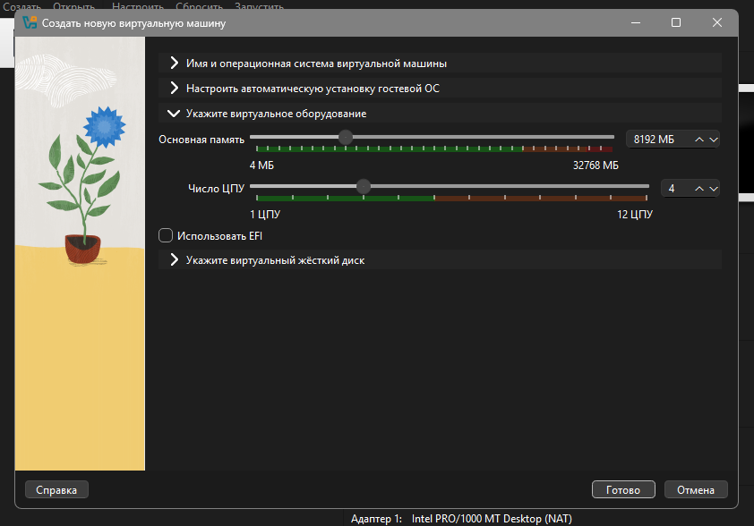

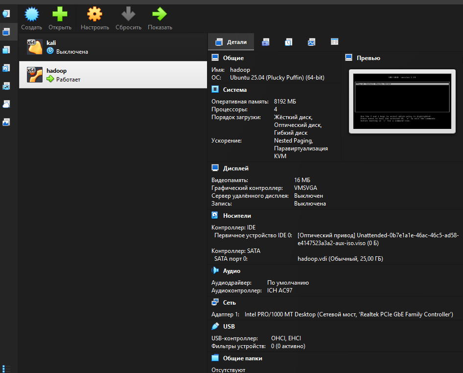

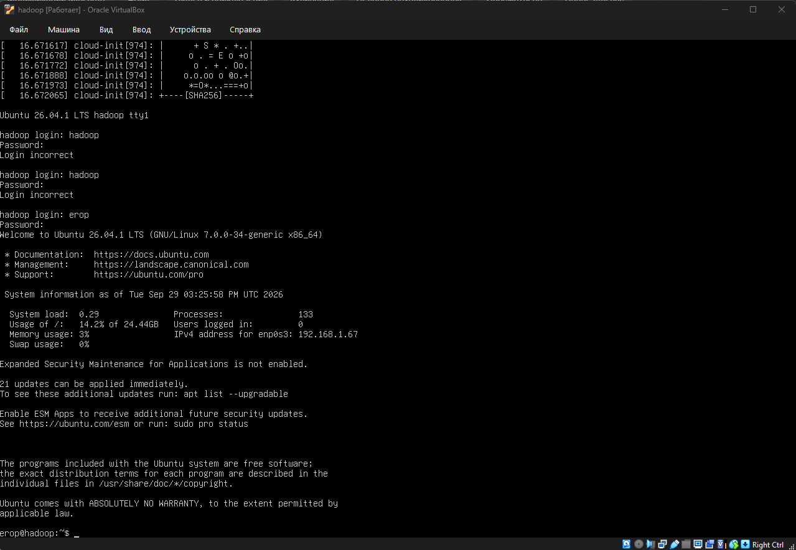

## Установка Hadoop

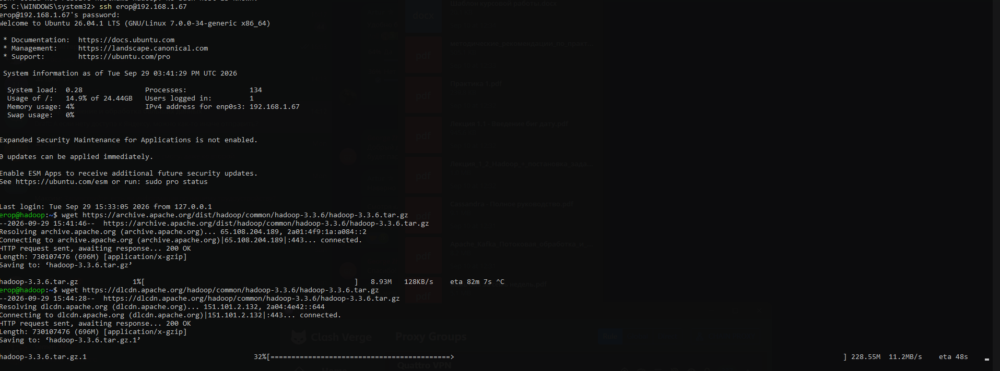

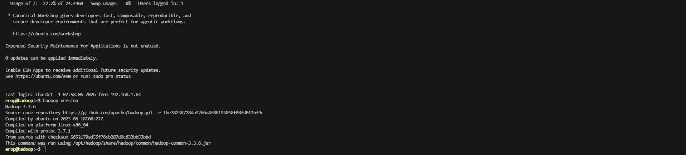

## КОНФИГУРАЦИЯ HADOOP

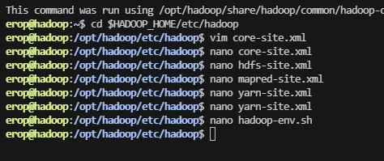

Настроил конфиг файлы по методичке

## ПОДГОТОВКА К ЗАПУСКУ

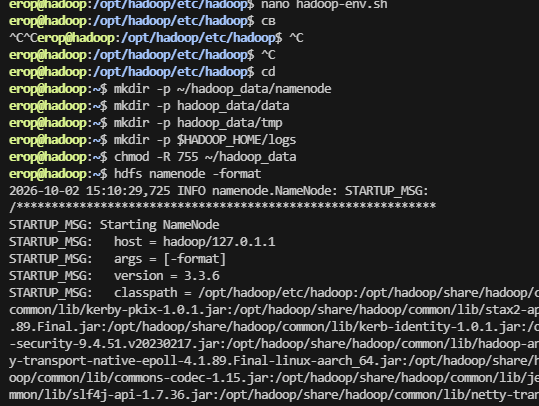

Подготовил

## ЗАПУСК КЛАСТЕРА

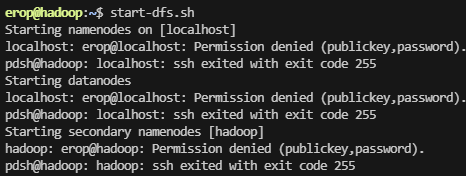

Ругается

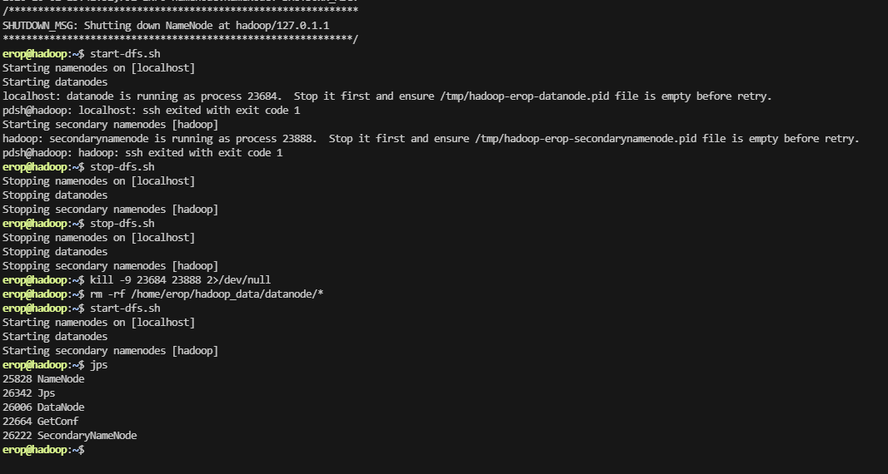

Запустил

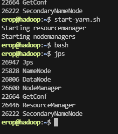

Yarn тоже

## ТЕСТИРОВАНИЕ И РАБОТА С ИНТЕРФЕЙСАМИ

### Namenode интерфейс

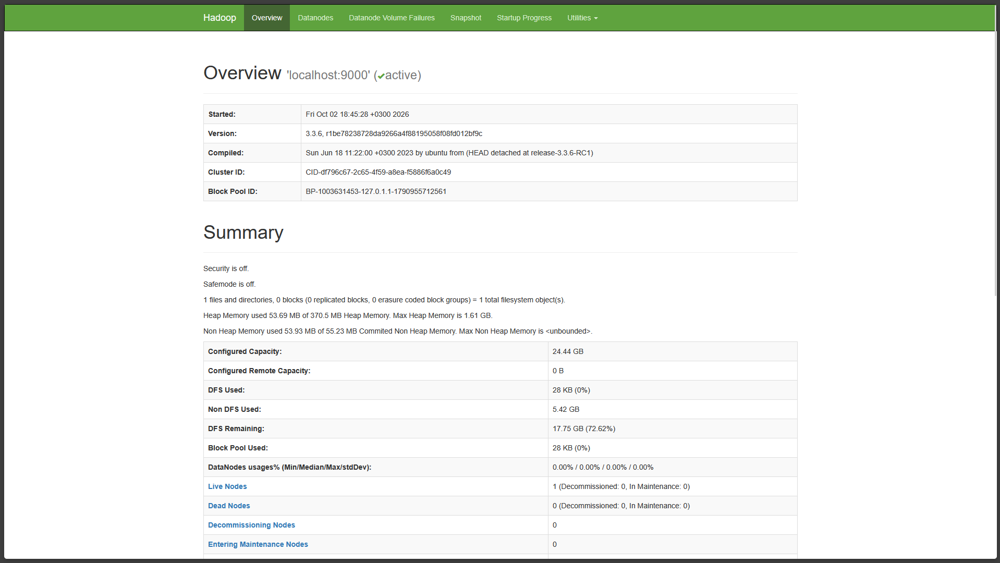

Работает ✅✅✅✅

### RM интерфейс

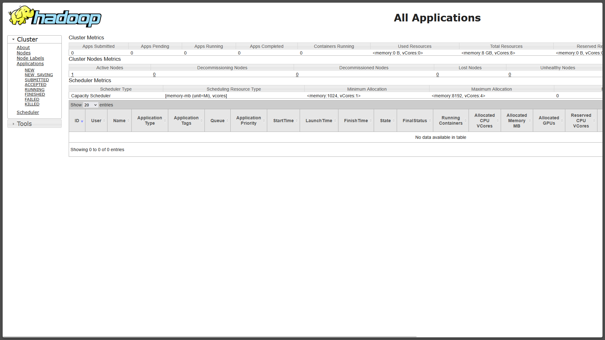

Проблемы с масштабированием веб интерфейса

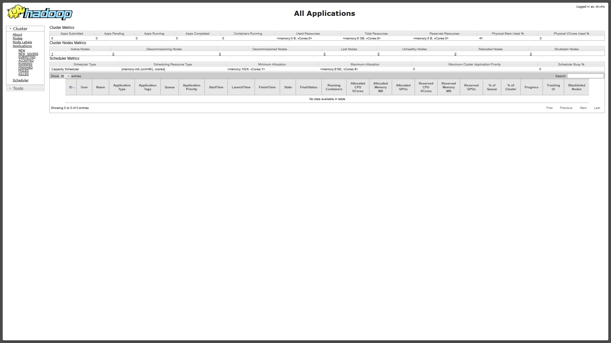

### Базовые операции с HDFS

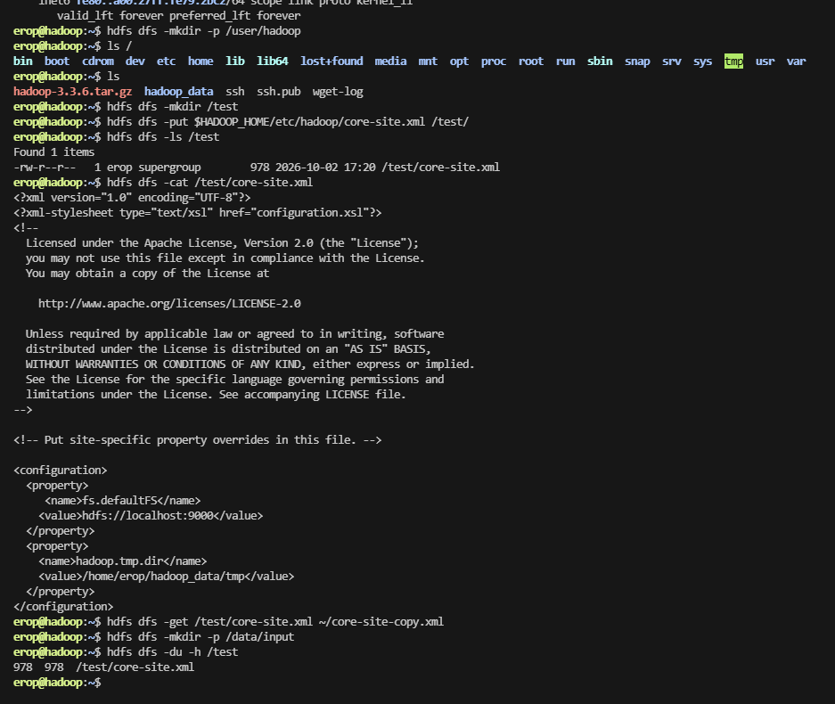

## ВЫПОЛНЕНИЕ T3

### Создание тестовых данных

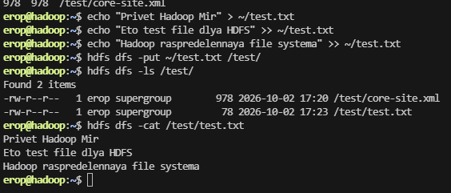

### Запуск тестового MapReduce задания

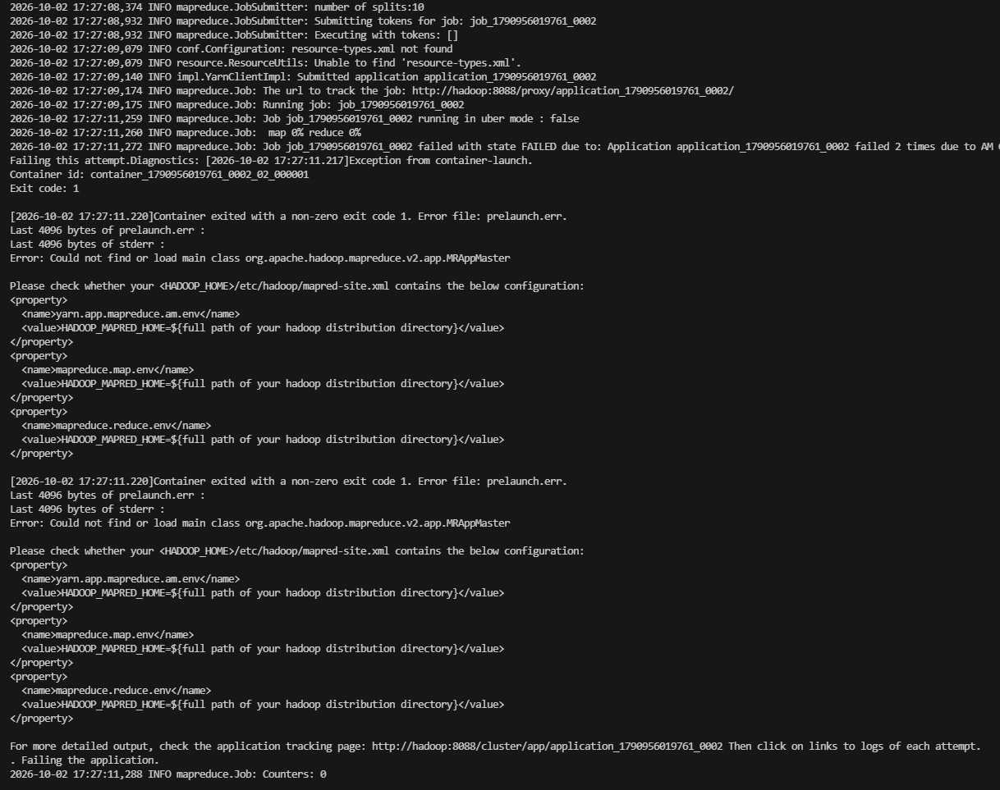

Ошибка

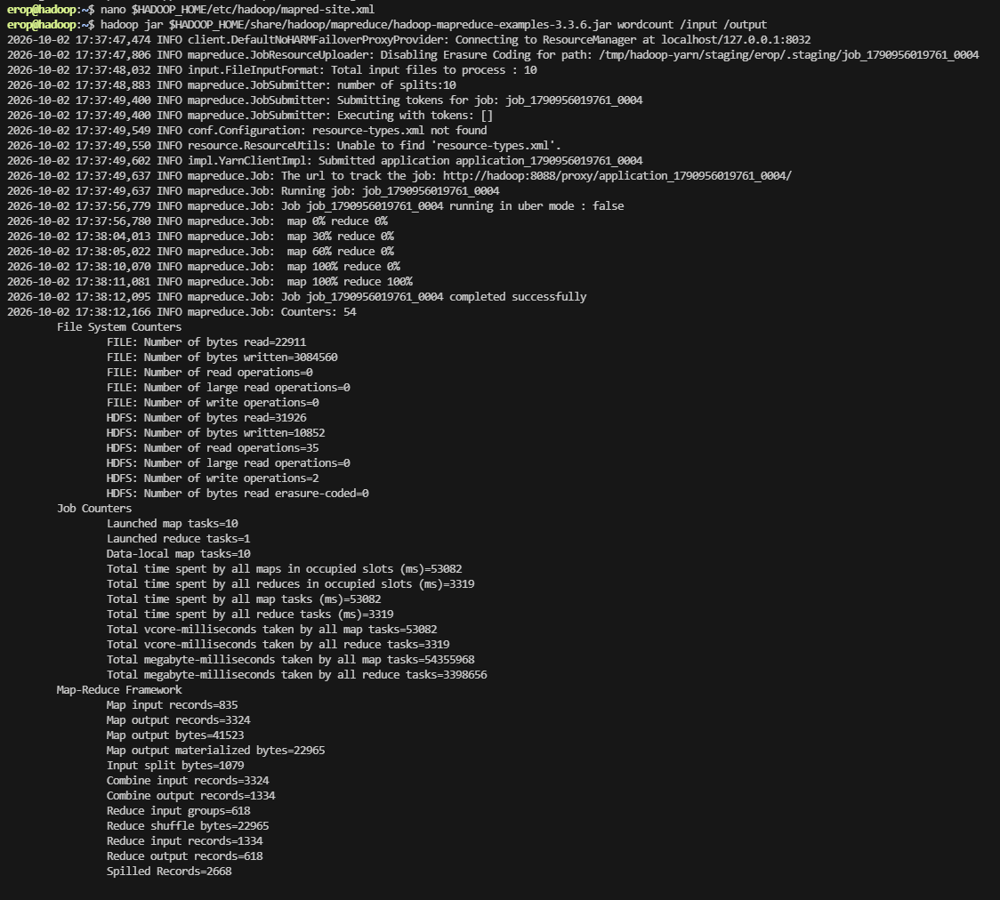

Исправил

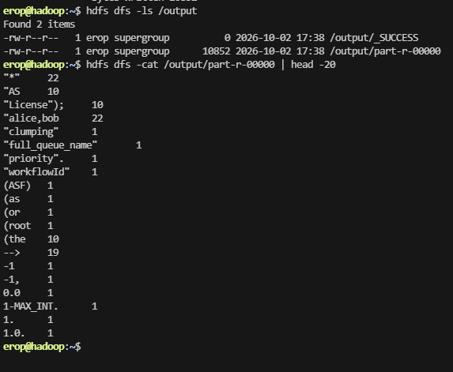

Вывод

## Ответы на контрольные вопросы

**Объясните разницу между standalone и pseudo-distributed режимами Hadoop.**

В стендэлоне сами демоны нэймнод, датанод, нодмэнэджер, … не запущены, а в псевдо-распределенном режиме все запущено, но на одной машине, поэтому и псевдо-..

**Вопрос 2: Изучив веб-интерфейс NameNode, ответьте:**

- Общий объем хранилища в кластере

- Количество живых узлов (Live Nodes)

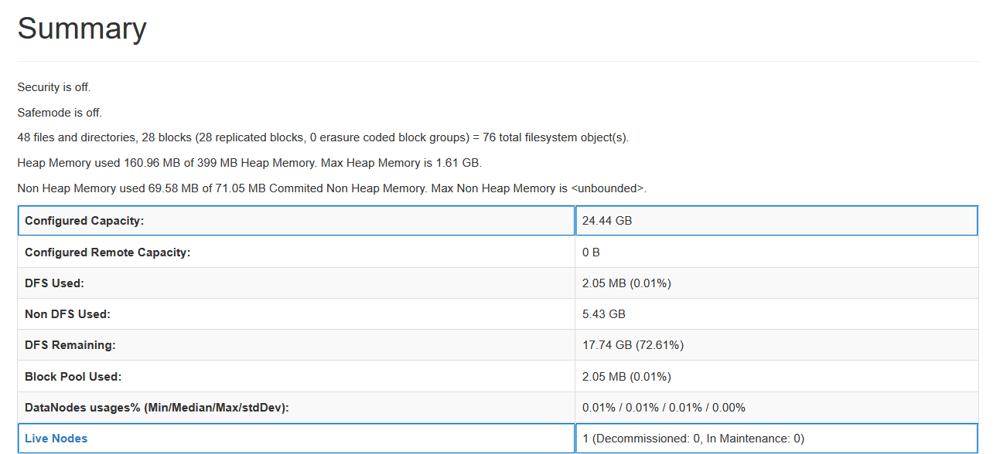

- Какая директория является корневой в HDFS

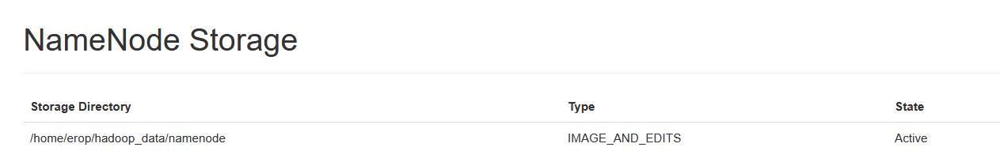

**Вопрос 3: Что отображается на главной странице веб-интерфейса ResourceManager?**

Метрики и логи (скрин ниже)

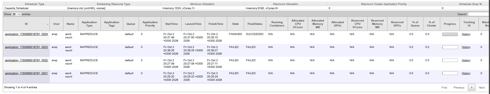

**Вопрос 4: Опишите процесс копирования файла из локальной ФС в HDFS на уровне демонов Hadoop.**

1. Запрос в нэймнод

2. Разрезка на блоки и разложение в 3 датаноды по цепочке. Сначала в первую, потом во вторую, потом в третью

3. Проверка целостности обратно по цепи 3 2 1

4. Готово