# Лабараторная работа №2
# Выполнил Кудрявцев Е.А. ЦИИ-171

## Подключение к кластеру и проверка доступности

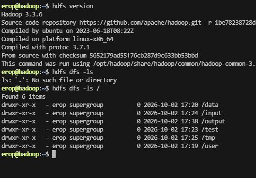

## Создание иерархической структуры директорий

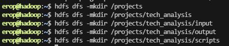

## Создание тестовых файлов на локальной машине

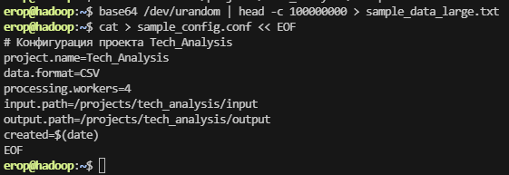

## Загрузка файлов в HDFS

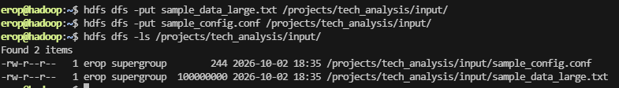

## Операции с файлами внутри HDFS

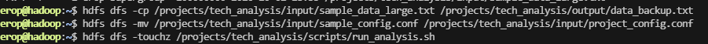

## Проверка созданной структуры

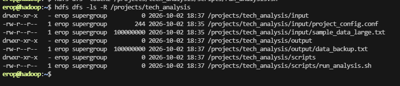

# УПРАВЛЕНИЕ ПРАВАМИ ДОСТУПА

## Определение текущих прав и владельцев

- владелец: я
- группа: supergroup
- права доступа: чтение запись

## Изменение владельца и группы

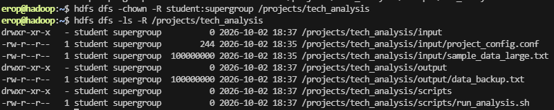

## Настройка прав доступа для директорий

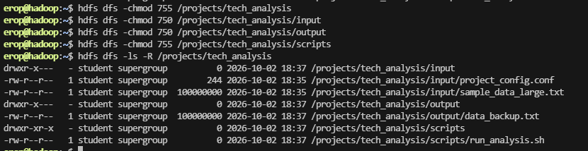

## Настройка прав доступа для файлов

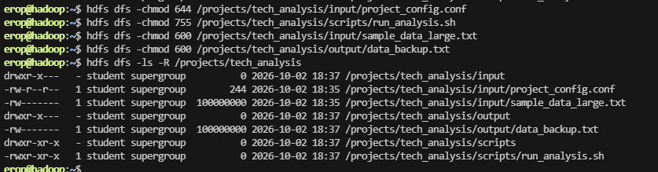

## Проверка работы системы прав

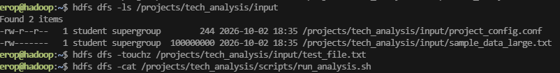

# ИЗУЧЕНИЕ МОДЕЛИ ДАННЫХ И МОНИТОРИНГ

## Подготовка файла для анализа блоков

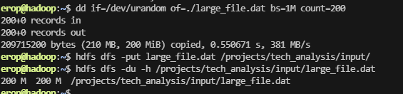

## Анализ файловой системы с помощью fsck

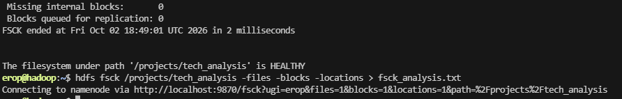

## Анализ вывода fsck

### Для большого файла (large_file.dat):

- Общее количество блоков: 2 block(s)
- Размер каждого блока: 0. len=134217728, 1. len=75497472
- Фактический коэффициент репликации для каждого блока: Live_repl=1

### Для маленького файла (project_config.conf):

- Общее количество блоков: 1 block(s)
- Размер каждого блока: len=244
- Фактический коэффициент репликации для каждого блока: Live_repl=1

### Расположение реплик):

- IP-адреса или имена DataNodes для нескольких блоков:
- Принадлежность к стойкам

/projects/tech_analysis/input/large_file.dat,

0 [127.0.0.1:9866,DS-42ab6b83-b9a6-458a-857c-4777347f1aa9,DISK]

1 [127.0.0.1:9866,DS-42ab6b83-b9a6-458a-857c-4777347f1aa9,DISK]

/projects/tech_analysis/input/project_config.conf,

0 [127.0.0.1:9866,DS-42ab6b83-b9a6-458a-857c-4777347f1aa9,DISK]

## Мониторинг состояния кластера

- Общее количество DataNodes: Live datanodes (1)
- Количество живых (Live) и мертвых (Dead) узлов: мертвых нет
- Общий объем дискового пространства (Configured Capacity): Configured Capacity: 26238750720 (24.44 GB)
- Используемый объем (DFS Used) и Свободное пространство (DFS Remaining):

DFS Remaining: 18321219584 (17.06 GB)

DFS Used: 415096832 (395.87 MB)

## Анализ использования дискового пространства

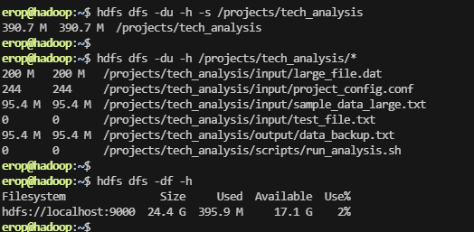

# АДМИНИСТРИРОВАНИЕ И МОДЕЛИРОВАНИЕ СБОЯ

## Подготовка к моделированию сбоя

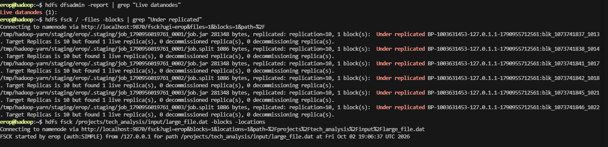

## Моделирование сбоя DataNode

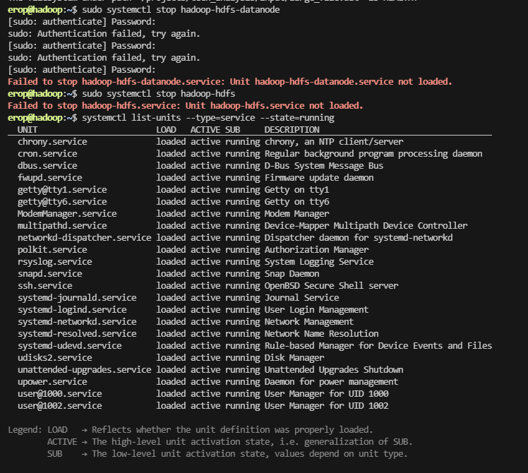

Хдфс не нашел (даже в --state=inactive), хотя веб работает… простите…

# Контрольные вопросы для отчета

**Объясните разницу между командами hdfs dfs -put и hdfs dfs -copyFromLocal. В каких случаях предпочтительнее использовать каждую из них?**

- copyFromLocal  это put, только жестко источник локальный, то есть он падает, если случайно передать HDFS-путь, тогда как -put сделает операцию

**Что произойдет, если попытаться создать директорию с помощью -mkdir без ключа -p, когда родительские директории не существуют?**

- Операция завершается ошибкой, ничего не создаётся

**Почему для рабочих директорий (input, output) устанавливаются более строгие права (750), чем для корневой директории проекта (755)?**

- корень обязан быть 755  иначе пользователи и демоны, которым нужен доступ к своим подкаталогам, не смогут пройти через корень. Сам корень при этом не содержит данных, так что r для other раскрывает только имена верхнеуровневых каталогов.

**Что означает право 'x' для файла в HDFS и чем оно отличается от права 'x' в традиционных файловых системах Linux?**

- В HDFS ‘x’ у обычного файла не даёт права на исполнение, а в Linux ‘x’ на регулярном файле – разрешение ядру выполнить execve

**Сколько блоков занимает файл размером 200 МБ в кластере с размером блока 128 МБ? Какой размер у последнего блока и почему?**

- Два блока по 128 МБ и 72 МБ

**Основываясь на расположении реплик разных блоков, можете ли вы сделать предположение о том, используется ли в кластере Rack Awareness? Какие данные из вывода fsck подтверждают вашу гипотезу?**

- Rack Awareness в кластере не используется, в кластере один DataNode (Number of data-nodes: 1), одна стойка (Number of racks: 1), коэффициент репликации равен 1 (Default replication factor: 1, у всех блоков Live_repl=1)

**Опишите полную последовательность действий HDFS при обнаружении "мертвого" DataNode: от пропуска Heartbeat до полного восстановления коэффициента**

1. Запуск мертвого узла sudo systemctl start hadoop-hdfs-datanode
2. Переодичкски проверять состояние репликации hdfs fsck /projects/tech_analysis -blocks | grep "Under replicated"

**Почему балансировку кластера обычно запускают вручную, а не настраивают на автоматическое выполнение**

- Потому что нужно наблюдение, при автомате можно что-то упустить
